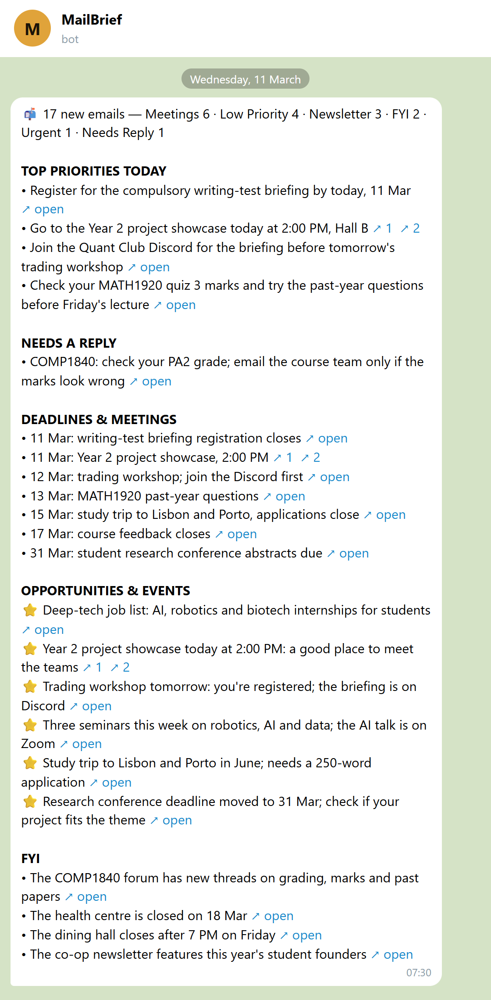

# MailBrief

**A self-hosted AI digest for Microsoft 365 Outlook, delivered to Telegram.**

MailBrief reads new mail from Outlook on the web, sorts it with an AI model you choose, and sends a short morning brief to Telegram. In the same private chat you can ask questions about your saved email and follow source links back to Outlook.

[](https://github.com/KidCoderT/mail-manager/actions/workflows/ci.yml)
[](LICENSE)


[Website](https://kidcodert.github.io/mail-manager/) · [Setup guide](https://kidcodert.github.io/mail-manager/setup.html) · [Command reference](commands.md) · [Design notes](docs/design.md) · [How the code works](teaching/README.md) · [Changelog](CHANGELOG.md)

<p align="center"><picture>
  <source media="(prefers-color-scheme: dark)" srcset="website/assets/showcase-dark.png">
  
</picture><br><sub>A real digest's layout; every name, course, place and date in it is invented.</sub></p>

## Why MailBrief

Your mail stays in your Outlook account. MailBrief runs on a machine you control, uses the AI endpoint you choose, and sends the useful part to the chat you already check. There is no MailBrief cloud account to hand your mailbox to.

## What it does

- Classifies new messages by urgency and type, with short summaries, action items and dates.
- Sends a linked digest and a separate upcoming-events calendar to Telegram.
- Answers questions about archived mail in your registered private Telegram chat, with quotes, source messages and attachment buttons.
- Adds its own `MB:` categories in Outlook, including your own course, sender and topic rules.
- Runs on demand or on a schedule with `mailbrief serve`. Docker Compose is included for an always-on server.

**What it will not do:** delete, move, send, reply to, or mark messages as read. Its only Outlook write is adding or updating its own `MB:` categories, and the code refuses every other kind of write. Set `OUTLOOK_LABELS=off` to turn even that off.

## Requirements

- A Microsoft 365 work or school account used with Outlook on the web at `outlook.office.com`. Personal Outlook.com accounts are not supported.
- Python 3.11+ and [uv](https://docs.astral.sh/uv/) on Windows, Linux or macOS; or Docker for an always-on server.
- A Telegram account and a bot token from [@BotFather](https://t.me/BotFather).
- An OpenAI-compatible AI endpoint, such as one your organisation runs or a local Ollama. There is no default: you decide where email text is sent. The full feature set needs a chat model, an image-capable model and an embedding model.

Want to look around first? The offline demo runs on 15 invented emails and needs no Outlook account, Telegram bot or AI endpoint:

```bash
uv sync
uv run python demo/run.py          # or add: events, email, thread, digest, chat
```

## Quick start

```bash
git clone https://github.com/KidCoderT/mail-manager.git
cd mail-manager
uv sync
uv run playwright install chromium --no-shell     # about 200 MB, once
```

Copy the example configuration (`cp .env.example .env`, or `Copy-Item .env.example .env` in PowerShell) and generate an encryption key:

```bash
uv run python -c "from cryptography.fernet import Fernet; print(Fernet.generate_key().decode())"
```

Set `SESSION_ENCRYPTION_KEY` to that output, then fill in `AI_BASE_URL`, the model names your endpoint serves, and `TELEGRAM_BOT_TOKEN`. `AI_API_KEY` can stay empty for a local endpoint without authentication. Keep the encryption key safe: it unlocks the saved Outlook session and the encrypted archive.

In Telegram, create a bot with `/newbot` in @BotFather, set `/setjoingroups` → **Disable** so nobody can add it to a group, and send your bot any message. Then sign in and send your first digest:

```bash
uv run mailbrief login                        # a browser opens: sign in, finish MFA, tick "Stay signed in", press Enter here
uv run mailbrief add-destination telegram     # pick your chat; a test message arrives
uv run mailbrief run --send --commit          # your first digest (the last 24 hours)
```

`--send` delivers the digest and `--commit` moves the cursor forward once it was delivered, so the next run only covers newer mail.

For chat search across your whole inbox, archive it and build the search index (optional):

```bash
uv run mailbrief run --backfill
uv run mailbrief index rebuild
```

Then leave MailBrief running. It sends a digest at 07:30 by default and answers your Telegram chat (`/help` there lists the commands):

```bash
uv run mailbrief serve
```

`uv run mailbrief autostart on` starts it hidden at Windows logon. On a server, use the same `.env` with `docker compose up -d --build`; see [commands.md §7](commands.md#7-running-automatically) for volumes and signing in remotely. `uv run mailbrief --help` lists every command, each with examples.

## Using it

| Where | What |
|---|---|
| Telegram | ask anything in plain words · `/sync` check for mail now · `/digest` · `/events` · `/rules`, `/rule add …` · `/login` when the sign-in expires · `/help` |
| Terminal | `mailbrief emails` browse the archive · `mailbrief events` · `mailbrief chat` · `mailbrief rules add course CS2040S` · `mailbrief labels status` · `mailbrief status` |
| Outlook | filter by the `MB:` categories (`MB: Urgent`, `MB: P1`, `MB: CS2040S` …) on web, desktop and phone |

## Configuration

Every setting lives in `.env`; `.env.example` has the same list with comments. Change model names to match your endpoint.

| Setting | Default | Purpose |
|---|---|---|
| `AI_BASE_URL` | required | OpenAI-compatible API base URL. Email text is sent here. |
| `AI_API_KEY` | empty | Bearer key; empty is fine for a keyless local endpoint. |
| `AI_CLASSIFIER_MODEL` | `qwen3.6:35b` | Classifies text-only email. |
| `AI_VISION_MODEL` | `qwen3.6:35b` | Classifies email with images; must accept images. |
| `AI_DIGEST_MODEL` | `qwen3.8:27b` | Writes the digest from the classification results. |
| `AI_ANSWER_MODEL` | `qwen3.8:27b` | Writes answers in inbox chat. |
| `AI_EMBED_MODEL` | `bge-m3` | Embeddings for the chat search index. |
| `AI_FALLBACK_MODEL` | classifier model | Used when another model doesn't answer in time; empty disables it. |
| `AI_CHAT_TEMPLATE_KWARGS` | `off` | `on` only for Qwen/Ollama endpoints that accept `enable_thinking`. |
| `TELEGRAM_BOT_TOKEN` | required | From @BotFather, for delivery and chat. |
| `SESSION_ENCRYPTION_KEY` | required | Fernet key for the saved session and the encrypted archive. |
| `DEFAULT_TIMEZONE` | `Asia/Singapore` | Time zone for schedules and dates. |
| `RUN_AT` | `daily 07:30` | When `serve` runs, e.g. `daily 07:30; sun 20:00 this-week` ([syntax](commands.md#7-running-automatically)). |
| `OUTLOOK_LABELS` | `on` | Apply the `MB:` categories in Outlook. |
| `ARCHIVE_DAYS` | `0` | Days to keep archived mail; `0` keeps it all. |
| `REMOTE_IMAGES` | `on` | Download eligible linked newsletter images for the model; their servers see your IP. |
| `EVENTS_DAYS` | `14` | Days ahead in the upcoming-events message; `0` turns it off. |
| `CHAT` | `on` | Let `serve` answer your registered private chat; `off` keeps Telegram send-only. |
| `BROWSER_WS_URL` | empty | Empty uses local Chromium. |
| `PUBLIC_URL` | host's address or localhost | HTTPS address of the remote sign-in page. |
| `PORT` | `8080` | Port of the temporary remote sign-in page; hosts may set it. |
| `LOGIN_PAGE` | unset | `always` for hosts that require a listening port. |
| `LOGIN_TUNNEL` | unset | `cloudflared` for phone sign-in from a PC; see the privacy notes below. |

## How it works

1. You sign in to Outlook once in a Playwright-controlled Chromium. MailBrief encrypts the saved session.
2. A run reads the inbox through Outlook on the web's internal interface, fetches the full message text, and classifies new mail with your AI endpoint.
3. The digest model gets the sender, subject and classification of each email, not the email bodies, and writes the summary. MailBrief saves the archive, applies its own Outlook categories (if enabled), and sends the digest to Telegram.
4. `serve` runs the schedule in your time zone and answers commands from your registered private Telegram chat.

The architecture, every component and the trade-offs behind them are in the [design notes](docs/design.md). [teaching/](teaching/README.md) walks through the code itself, module by module, with the real source and the reasons for it.

## Privacy and limits

- MailBrief is a personal project, not affiliated with or endorsed by Microsoft or Telegram. It comes with no warranty ([MIT License](LICENSE)).
- It uses Outlook on the web's internal interface, not a supported Microsoft API. It can break when Outlook changes, and automated access may conflict with your organisation's IT policy. Check that policy, and use it only on your own mailbox.
- The browser session, archive, index and logs live in `data/` on the machine running MailBrief. The session and archive are encrypted with `SESSION_ENCRYPTION_KEY`; protect both the key and the machine.
- Email text goes to the endpoint in `AI_BASE_URL`, and that operator's retention policy applies. A local or organisation-run endpoint keeps it under your control.
- Digests, questions, answers and the files you ask for go through Telegram. Telegram bot chats are not end-to-end encrypted.
- With `REMOTE_IMAGES=on` (the default), image servers linked from newsletters can see your IP. Set it to `off` to skip them.
- `LOGIN_TUNNEL=cloudflared` is opt-in. Cloudflare can see the traffic through that tunnel, sign-in included; plain `mailbrief login` is safer when you can use it.
- Running it on a third-party server means that server holds your archive, session and key.
- Sign-ins expire on your organisation's schedule; MailBrief tells you on Telegram. Autostart is Windows-only; on Linux and macOS use Docker or your own service manager.

Found a security problem? See [SECURITY.md](SECURITY.md).

## Roadmap

Ideas, not promises: text from attachments in search, more delivery channels, voice questions, other mail providers and a web dashboard. Gmail and other providers are **not supported today**. MailBrief is built for one person and their own mailbox; there will be no hosted multi-user version.

## Contributing

Issues and focused pull requests are welcome. For a larger change, open an issue first to discuss it. Never put real email, credentials, session files or private logs in issues or tests; use invented fixtures.

The checks CI runs need no browser, network, Outlook account or AI endpoint:

```bash
uv sync --frozen
uv run ruff check mailbrief tests demo scripts
uv run mypy mailbrief
uv run pytest -q
```

## License

[MIT](LICENSE)
